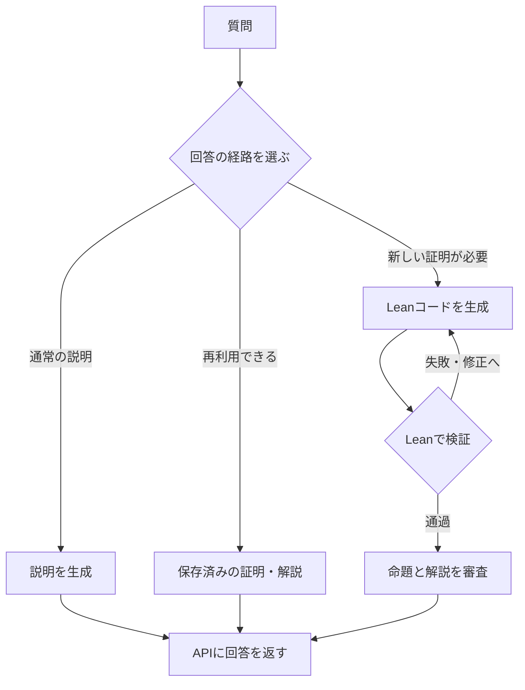

# pals-agent

pals-agentは、[PALS](https://github.com/AtsushiHosaka/pals)で数学の質問を処理するエージェントと、Lean 4の検証サービスを収めた公開リポジトリです。質問の種類を判定し、検証済みの証明を再利用するか、Leanコードを新しく生成します。検証を通った証明から解説を作り、回答をAPIに返します。

## エージェントの構成



### 質問の評価

assessment workerは、SQSの評価キューから要求を受け取り、APIから質問や前提を取得します。質問に応じて、説明を返すか、検証済みの証明と解説をまとめたRecipeを照合します。再利用の条件は、入力の前提・結論・指定された証明方法が候補と対応することです。新しい形式証明が必要な場合は、APIが証明のジョブを作ります。

### 証明の生成

proof workerは、証明の方針を立てるDraft、中間命題を含む骨格を作るSketch、各証明を埋めるProveを進めます。検索で得たDraftは、構成に応じて新しい証明の参考資料です。エラーが出た候補は診断と一緒に記録し、該当する段階から修復します。

### 検証と回答

proof workerがLeanコードと成果物をAPIに登録し、API側のReconcilerが隔離されたLean verifierに検証を依頼します。workerが結果を受け取る窓口はAPIです。コンパイル後は証明した命題が質問に対応するかを照合し、検証済みコードから作った解説も審査します。

モデルの既定値は[model_roles.py](pals_agent/model_roles.py)にあります。Draft・Sketch・Prove・RepairはGPT-6.1 Terraのmedium、OpenMath・修復先の選択・ランキング・解説・審査はGPT-6 Lunaのlowです。利用者がLean生成モデルを指定した場合は再試行でもその指定を使います。

## コードの入口

| 探しているもの | 参照先 |
| --- | --- |
| PALSの全体構成とWeb画面を含むローカル起動 | [親リポジトリ](https://github.com/AtsushiHosaka/pals) |
| 質問の判定・既存の証明の再利用 | [chat_runtime.py](pals_agent/chat_runtime.py) · [proof_reuse.py](pals_agent/proof_reuse.py) |
| 新しい証明の生成と修復 | [pipeline.py](pals_agent/pipeline.py) · [worker.py](pals_agent/worker.py) |
| Leanを実行するサービス | [lean_verifier](pals_agent/lean_verifier/) · [検証器のDockerfile](docker/lean-verifier.Dockerfile) |
| テストと評価 | [tests](tests/) · [testdata](testdata/) · [CLI](pals_agent/cli.py) |

## ローカルで始める

CLIと単体テストは、PALSの非公開リポジトリを取得せずに使えます。必要なのはPython 3.12以上と[uv](https://docs.astral.sh/uv/)です。リポジトリのルートで次を実行すると、固定された依存関係をインストールし、CLIの使い方を確認できます。

```bash
uv sync --locked --extra dev
uv run --no-sync pals-agent --help
```

単体テストを実行する例です。Leanやデータベースなどを使う統合試験の前提は、テストごとの設定と[GitHub Actionsの回帰ワークフロー](.github/workflows/application-regression.yml)を参照してください。

```bash
uv run --no-sync python -m pytest tests/unit
```

Web・API・LocalStack・worker・Lean verifierをそろえて動かす場合は、親リポジトリの `make pals-up` を使います。親から `make agent-test` を実行すると、テストに加えてruffとmypyも実行します。モデルを実際に呼ぶベンチマークには、モデルの接続設定などが必要です。サブコマンドの引数は `uv run --no-sync pals-agent benchmark --help` で確認できます。

## WorkerとLean verifier

workerと検証器は別のイメージにします。コンパイルは専用verifierで行い、モデルやデータベースの認証情報はコンパイラへ渡しません。verifierのアプリケーション呼び出し元はAPI側のReconcilerです。プライベートなTLS 1.3の相互認証をポート18117で受け付け、証明書・ツールチェーン・実行環境の検査に失敗すると起動を中止します。

```bash
docker build -f docker/lean-verifier.Dockerfile -t pals-lean-verifier .
docker build -t pals-agent-worker .
```

verifier起動時の証明書・鍵・CAは、インフラが用意するSecretBinaryの完全ARNと不変のVersionIdで指定します。設定と配置の担当は親リポジトリのインフラです。[Lake実行環境の再利用](tools/lean_acceleration/README.md)は既定で無効です。有効時も新しい証明ごとにコンパイルを行い、Recipeの登録審査では検証記録に結び付いたコンパイルを使います。

| 本番サービス | 利用するイメージと起動条件 |
| --- | --- |
| 評価worker | [Dockerfile.natural-production](Dockerfile.natural-production)と[起動スクリプト](scripts/start-worker-with-credentials.sh)。`PALS_PROOF_CAPABILITY=natural-only`、`--lane assessment` |
| 証明worker | [Dockerfile.full-production](Dockerfile.full-production)。`PALS_PROOF_CAPABILITY=full`、`--lane proof` |
| 両サービスで同じ署名済みイメージを使う場合 | fullイメージでサービスごとにcapabilityとコマンドを指定。評価workerのコマンドは `sh /app/scripts/start-worker-with-credentials.sh --lane assessment` |

本番では `PALS_ENV=prod`、`PALS_TOKEN_ACCOUNTING_ENABLED=true` を設定し、`PALS_PROOF_REQUESTS_QUEUE_URL` と `PALS_PROOF_JOBS_QUEUE_URL` を別々のキューに向けます。キュー設定には `PALS_SQS_*` の別名も使用できます。起動時に検査するのは、定期更新されるworker資格情報と固定の本番リージョンです。

ローカルworkerは、LocalStack上のキュー、PALS API、モデルの接続先、成果物保存先を使います。主な設定は[settings.py](pals_agent/settings.py)を参照してください。モデルの出力上限は `PALS_OPENAI_MAX_OUTPUT_TOKENS`、修復回数は `PALS_MAX_REPAIR_ATTEMPTS` で設定します。既定の修復回数は初回生成に続く6回です。

`verified` 状態をAPIへ送る際は、空でないLeanコードと成果物URIに加え、検証器の証跡を添えます。証跡は `pals.verifier-attestation.v1` のスキーマ版、ジョブID、LeanのUTF-8バイト列のSHA-256、同じ成果物URI、検証成功フラグで構成します。中間・失敗・取消状態ではこの証跡を送信しません。[APIクライアント](pals_agent/api_client.py)

## 証明方針の検索と評価

Proof Flow Indexは、OpenMathで表した命題から関連する証明方針を取る機能です。workerは正規化した質問からベクトルと照合用の指紋を作り、認証されたAPIに検索を依頼します。データベースへのアクセスとカタログ公開の担当はAPIです。候補は厳密なスキーマで審査し、検索に使う埋め込みの設定や版を照合できる場合だけ利用します。[実行経路](pals_agent/proof_flow_runtime.py) · [再ランキング](pals_agent/proof_flow_reranker.py)

署名済みworkerイメージを作るときは、承認済みのソースを固定します。次のコマンドはベースイメージのXMLライブラリを計測し、生成したseedとイメージ内の来歴情報が一致するかを検査します。ビルドディレクトリ `build/proof-flow-index/` が存在しない状態で実行してください。

```bash
uv run --no-sync pals-agent build-pfi-worker-image \
  --source-commit '<40桁のコミットSHA>' --tag pals-agent-worker
```

公開seedの単位は、定理文、OpenMath命題、方針、順序付きのSketch手順です。標準のOpenMath辞書に加え、PALS固有の位相・線形代数の記号は[辞書pals1](pals_agent/content_dictionaries/pals1.ocd)に定義します。実行時は、記号の識別子、引数の個数、許可された構文を検査します。

- [手動のリリース評価](pals_agent/proof_flow_release_evaluator.py)では、承認済みコーパス、公開中の世代、マニフェスト、埋め込み設定を有料呼び出し前に照合します。記録には入力やモデル出力を含めず、暗号化と保持・削除要件を満たす専用ストアを使います。
- [意味評価器](pals_agent/semantic_evaluation.py)は任意です。利用する場合は `PALS_SEMANTIC_EVALUATOR_PROVIDER`、`PALS_SEMANTIC_EVALUATOR_MODEL`、`PALS_SEMANTIC_EVALUATOR_REVISION`、`PALS_SEMANTIC_EVALUATOR_BASE_URL` の4つを設定します。生成とは異なるprovider/modelの組を固定し、未設定時は評価結果を `not_evaluated` と記録します。
- 評価履歴の旧形式を移行する場合は `pals-agent evaluation-history-migrate --help` を参照してください。通常の読み込みは記録の不整合で停止します。明示的な移行には元ファイルのSHA-256が必要で、元の内容を権限0600のバックアップに残します。

## 品質と任意の機能

[品質イベント](pals_agent/quality_events.py)は既定で無効です。`PALS_QUALITY_EVENTS_ENABLED=true` を指定すると、証明要求・コンパイル試行・解説失敗・評価の結果をCloudWatch EMFの `PALS/ProofQuality` 名前空間に記録します。質問文、Leanソース、モデル出力、利用者識別子、認証情報はイベントの対象外です。環境や送信方式は `PALS_QUALITY_EVENTS_ENVIRONMENT`、`PALS_QUALITY_EVENTS_TRANSPORT`、`PALS_QUALITY_EVENTS_AGENT_ENDPOINT`、`PALS_QUALITY_EVENTS_FILE`、`PALS_QUALITY_EVENTS_REVISION` で指定します。

[幾何の実験用CLI](pals_agent/synthetic_geometry.py)は、二等辺三角形の頂点と底辺の中点を結ぶ線が底辺と直交することを、明示的な構造化入力からLeanで検証します。[入力例](testdata/synthetic-geometry-v1/isosceles-request.json)と固定したツールチェーンを使い、自然言語の解釈と図の描画は別に扱います。

```bash
uv run --no-sync pals-geometry testdata/synthetic-geometry-v1/isosceles-request.json \
  --lean-workspace "$PALS_GEOMETRY_LEAN_WORKSPACE"
```

## 貢献とライセンス

公開リポジトリでは、公開可能な実装・アダプター・評価データだけを管理します。APIキー、本番や非公開の接続先、AWSアカウント情報、非公開のプロンプトやデータ、ローカル環境ファイルはコミット対象外です。貢献前に[CONTRIBUTING.md](CONTRIBUTING.md)、脆弱性の報告先は[SECURITY.md](SECURITY.md)を参照してください。

[Apache License 2.0](LICENSE)
